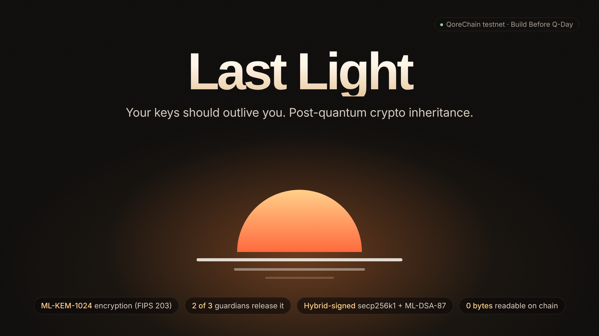

# Last Light



Post-quantum crypto inheritance on QoreChain.

**Try it:** https://last-light-ashy.vercel.app (open with `?demo` to run the whole flow in your browser with sample people, no wallet needed)

When someone dies holding crypto and nobody has the keys, the money is gone for good. Last Light lets you leave your seed phrase (or any wallet instructions) to someone you trust, so they can open it only after you stop checking in. Nobody can open it before that. Not the person you leave it to, not the people who help release it, and not anyone reading the chain.

A secret like this has to stay safe for years, maybe decades. Data encrypted today with classical cryptography can be stored now and broken later by a quantum computer ("harvest now, decrypt later"). Last Light encrypts everything with ML-KEM-1024 (NIST FIPS 203), to keys each person publishes on QoreChain.

Built for the QoreChain **Build Before Q-Day** Developer Fest, Encrypted Apps category.

## Encrypted Apps requirements

| Requirement | Where it is |
|---|---|
| ML-KEM-1024 encryption | Every envelope in `packages/crypto` (`@noble/post-quantum` ml_kem1024, then HKDF-SHA256 and AES-256-GCM). |
| Registered recipient keys | Heirs and guardians publish their ML-KEM-1024 public key on QoreChain with `MsgRegisterKEMKey`. Owners encrypt only to keys read from the chain (`/qorechain/pqc/v1/kem/{address}`). |
| ML-DSA key binding | Each key account registers an ML-DSA-87 key with proof of possession, and the KEM key is published in a hybrid-signed transaction (secp256k1 + ML-DSA-87). |
| Client-side encryption and decryption | Sealing, guardian handoffs and recovery all run in the browser. The contract and the chain only ever hold ciphertext. |

## How it works

There are three roles:

- **Owner:** the person protecting their crypto.
- **Heir:** the person who receives it.
- **Guardians:** three trusted people who help release it. Any two of them must agree before anything opens.

1. **Everyone publishes a key.** The heir and each guardian create an ML-KEM-1024 key pair in their browser and publish the public key on QoreChain (`msg.pqc.registerKemKey`, a hybrid-signed transaction from an account with a registered ML-DSA-87 key). The secret key never leaves their device.
2. **The owner seals a vault.** In the owner's browser, the secret is encrypted with a random vault key. That key is split into two halves:
   - **Half A** is sealed to the heir's key.
   - **Half B** is split again into one share per guardian, so that any two of the three guardians must act together. Each share is sealed to that guardian's key.
   Only the encrypted pieces go on chain.
3. **The owner checks in.** One transaction per period, for example every 90 days.
4. **Release.** If the owner misses a check-in, the contract marks the vault as released. Each guardian opens their share and seals it to the heir. The contract accepts these handoffs only after release.
5. **The heir recovers the secret.** Once two guardians have handed off, the heir rebuilds Half B, joins it with Half A into the vault key and decrypts the secret in their browser.

Before release, the heir holds only Half A and each guardian holds only one share of Half B. The heir plus one guardian cannot open the vault. The guardians together cannot open it either, because they never see Half A.

## Repository

| Folder | What |
|---|---|
| `packages/crypto` | Encryption core: ML-KEM-1024 envelopes, key split, guardian shares, seal, handoff and recover. Runs entirely on the user's device. |
| `contracts` | The LastLight vault contract: check-ins, release, guardian handoffs. Hardhat, deployed on the QoreChain EVM. |
| `web` | The app for owners, heirs and guardians. Vite, React, wagmi and the QoreX wallet. Has a demo mode that runs the whole flow in the browser with sample people. |

## Encryption details

- **Envelope:** ML-KEM-1024 encapsulation to the recipient's on-chain key, HKDF-SHA256, then AES-256-GCM.
- **Context binding:** every envelope is bound to the chain, the contract, the vault, the role and the recipient address. An envelope taken from one vault cannot be used in another.
- **Guardian shares:** Shamir secret sharing over GF(2^8), two of three by default. One unreachable guardian does not lock the heir out.
- **Length hiding:** secrets are padded to 1024 bytes, so the ciphertext does not reveal whether it holds a 12-word or a 24-word phrase.
- **Libraries:** audited `@noble/post-quantum`, `@noble/ciphers` and `@noble/hashes`.

## The contract

**Live on the QoreChain testnet:** [`0x639432e38d6fd52aa76cc6398fa584d23b60888e`](https://explore.qore.network/address/0x639432e38d6fd52aa76cc6398fa584d23b60888e) (EVM chain 9800, deployed in block 10106943, [deploy tx](https://explore.qore.network/tx/0x067bca1d8b30fbb84c8faf6e2e7fdf15f9dc41ecafd13cc92b3b0792cd90aa84)).


`LastLight.sol` never sees anything readable. It records who the owner, heir and guardians are, tracks check-ins, decides when a vault is released, and accepts guardian handoffs only after release. The encrypted pieces (about 8 KB per vault) are published in events instead of storage, which keeps sealing cheap. The contract stores a hash of them, so the app can confirm that what it reads from the logs is exactly what was sealed.

Each vault id is known before sealing (`nextVaultId`), because every encrypted piece is bound to its vault.

## Run the tests

```sh
cd packages/crypto && npm install && npm test     # encryption core
cd contracts && pnpm install && pnpm test         # contract, including a full seal, release and recover run
```

## The web app

**Live:** https://last-light-ashy.vercel.app

```sh
cd web
pnpm install
cp .env.example .env          # set VITE_LASTLIGHT_ADDRESS after deploying the contract
pnpm dev                      # http://localhost:5180
```

- **Demo mode** (`?demo`, or when no contract address is set): five sample people (owner, heir, three guardians), a simulated chain and a "skip time" button. The encryption is the real ML-KEM-1024 code.
- **Testnet mode:** connect the QoreX wallet. Vault actions are calls to the LastLight contract on the EVM lane, approved in QoreX.
- **Key accounts.** QoreX keeps encryption keys to itself and does not let websites publish one, so each heir and guardian gets a *Last Light key account*: an eth-native QoreChain account created in their browser from a backup phrase. Setting it up:
  1. QoreX sends it 0.5 test QOR (one approval).
  2. It registers its own ML-DSA-87 key (`MsgRegisterPQCKeyV2` with proof of possession).
  3. It publishes its ML-KEM-1024 key with `MsgRegisterKEMKey`, hybrid-signed (secp256k1 + ML-DSA-87), so the key is bound to an ML-DSA identity on chain.
  4. QoreX links it to the person's address on the contract with `linkNative` (one approval).
  Owners then find each person's key from their 0x address. The ML-KEM secret key derives from the key account's backup phrase and never leaves the browser; the app asks for a backup file.
- The browser reads the chain's REST API through `/lcd` (a Vite proxy in development, a rewrite in `vercel.json` when hosted), because the public endpoint sends no CORS headers.

## Deploy to the QoreChain testnet

```sh
cd contracts
cp .env.example .env          # add a testnet-only key, never commit it
pnpm window register          # once: register the account's ML-DSA-87 key
pnpm window open              # hybrid-signed: open an EVM window
pnpm deploy:testnet
```

## Known limits

- **Collusion.** If the heir and two guardians combine their pieces early, they can open the vault. One guardian working with the heir is not enough. Choose guardians who do not all answer to the heir.
- **Unreachable guardians.** If two of the three guardians are unreachable at release, the heir has to wait for one of them.
- **Lost keys.** If the heir loses their ML-KEM secret key, they cannot open the vault. The app asks every user to back up their key.
- **A compromised device.** Encryption happens in the browser, so the owner's browser and device must be trusted at the moment of sealing.
- **Testnet only.** This is a hackathon build on the QoreChain testnet. Use a test phrase. Never put a real seed phrase in it.

## Credits

Built during the event. These open source libraries and QoreChain kits are used:

- QoreChain: `@qorechain/sdk`, `@qorechain/evm`, `@qorechain/qorex-rainbowkit`, `@qorechain/qorex-types`, and the QoreX wallet
- Cryptography: `@noble/post-quantum`, `@noble/ciphers`, `@noble/hashes` (Paul Miller)
- Contracts: Hardhat and the Nomic Foundation Hardhat plugins, `viem`, `@cosmjs/stargate`
- Web app: React, Vite, wagmi, RainbowKit, TanStack Query
- Tests: Vitest

## How this was built

See [AI_USAGE.md](AI_USAGE.md).

## License

Apache-2.0
